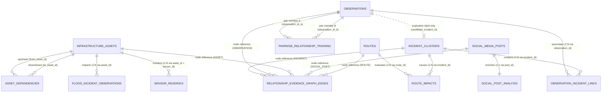
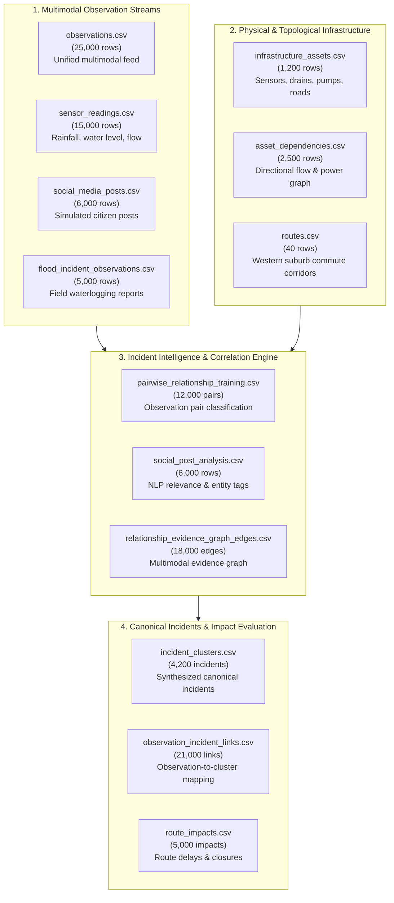

# UrbanPulse Expanded Dataset: Entity Relationships & Architecture

## 1. Executive Summary & Architecture Overview

UrbanPulse is an AI-powered multimodal urban incident intelligence engine designed for the **Mumbai Western Suburbs corridor** (spanning Bandra, Khar, Santacruz, Vile Parle, Andheri, Jogeshwari, Goregaon, Malad, Kandivali, Borivali, and Dahisar).

The expanded dataset consists of **13 relational and graph CSV files** comprising **120,940 total records**. It models the complete lifecycle of urban incidents:
1. **Multimodal Ingestion**: Telemetry sensor streams, citizen reports, weather feeds, official feeds, and social media posts.
2. **Infrastructure Graph Topology**: Catchment basins, drainage networks, pump stations, and transit infrastructure.
3. **Incident Synthesis & Clustering**: Multi-source correlation, deduplication, and canonical incident cluster formation.
4. **Impact Assessment**: Commuter route disruption, segment closures, and travel delay modeling.

---

## 2. Dataset Entity-Relationship Diagram (ERD)

---

## 3. Data Flow & Subsystem Breakdown

---

## 4. Detailed Cross-Table Relationship Matrix

| Source Table | Source Column | Target Table | Target Column | Cardinality | Audit Status | Referential Notes |
| :--- | :--- | :--- | :--- | :---: | :---: | :--- |
| `observation_incident_links.csv` | `observation_id` | `observations.csv` | `observation_id` | N:1 | **100% Valid (21,000/21,000)** | Every linked observation exists in observations stream. |
| `observation_incident_links.csv` | `incident_id` | `incident_clusters.csv` | `incident_id` | N:1 | **100% Valid (21,000/21,000)** | Every linked incident exists in canonical incident clusters. |
| `observations.csv` | `candidate_incident_id` | `incident_clusters.csv` | `incident_id` | N:1 | **100% Valid (21,000/21,000)** | 21,000 populated (100% match); 4,000 NULL (unassigned/singletons). **LEAKAGE HAZARD.** |
| `sensor_readings.csv` | `sensor_id` | `infrastructure_assets.csv` | `asset_id` | N:1 | **100% Valid (595/595)** | All 595 unique sensor IDs map to `TRAFFIC_SENSOR`, `RAIN_GAUGE`, `WATER_LEVEL_SENSOR`, `DRAIN`, `PUMP_STATION`. |
| `asset_dependencies.csv` | `from_asset_id` | `infrastructure_assets.csv` | `asset_id` | N:1 | **100% Valid (2,500/2,500)** | Upstream dependency asset exists. |
| `asset_dependencies.csv` | `to_asset_id` | `infrastructure_assets.csv` | `asset_id` | N:1 | **100% Valid (2,500/2,500)** | Downstream dependency asset exists. |
| `social_post_analysis.csv` | `post_id` | `social_media_posts.csv` | `post_id` | 1:1 | **100% Valid (6,000/6,000)** | Complete 1:1 parity between raw post and analytical extraction. |
| `flood_incident_observations.csv` | `asset_id` | `infrastructure_assets.csv` | `asset_id` | N:1 | **100% Valid (5,000/5,000)** | All 461 unique flood asset IDs map to infrastructure assets. |
| `pairwise_relationship_training.csv` | `observation_id_a` | `observations.csv` | `observation_id` | N:1 | **100% Valid (12,000/12,000)** | Observation A exists in unified stream. |
| `pairwise_relationship_training.csv` | `observation_id_b` | `observations.csv` | `observation_id` | N:1 | **100% Valid (12,000/12,000)** | Observation B exists in unified stream. |
| `route_impacts.csv` | `route_id` | `routes.csv` | `route_id` | N:1 | **100% Valid (5,000/5,000)** | All 40 routes exist in the route catalog. |
| `route_impacts.csv` | `incident_id` | `incident_clusters.csv` | `incident_id` | N:1 | **100% Valid (5,000/5,000)** | All 4,200 incident clusters match. |
| `relationship_evidence_graph_edges.csv` | `source_entity_id` | Various (by `source_entity_type`) | Corresponding PK | N:1 | **100% Valid (18,000/18,000)** | ASSET (1,166 unique), INCIDENT (2,719 unique), OBSERVATION (4,127 unique), SOCIAL_POST (3,190 unique). |
| `relationship_evidence_graph_edges.csv` | `target_entity_id` | Various (by `target_entity_type`) | Corresponding PK | N:1 | **14,463/18,000 Table Match** | ASSET (1,137), INCIDENT (2,421), OBSERVATION (3,347), ROUTE (40) 100% match; 3,537 edges point to 8 `LOCATION` anchors (`LOC-01` to `LOC-08`). |
| `relationship_evidence_graph_edges.csv` | `evidence_ids` | `observations.csv` | `observation_id` | N:M | **100% Valid (36,000/36,000)** | All semicolon-separated evidence tokens match valid observations. |

---

## 5. Subsystem Semantics & Special Referential Nuances

### 5.1 Observation `source_id` Semantics
In `observations.csv`, the column `source_id` does **not** reference individual item IDs (such as `POST-000001` or `READ-000001`). Rather, it stores channel feed identifiers:
- `SRC-CITIZEN_REPORT` (3,178 rows)
- `SRC-TRANSIT_FEED` (3,191 rows)
- `SRC-OFFICIAL_FEED` (3,159 rows)
- `SRC-SENSOR` (3,155 rows)
- `SRC-SIMULATED_TEST` (3,128 rows)
- `SRC-WEATHER_FEED` (3,074 rows)
- `SRC-TRAFFIC_FEED` (3,068 rows)
- `SRC-SOCIAL_MEDIA` (3,047 rows)

This structure models streaming ingestion channels rather than direct foreign keys.

### 5.2 Knowledge Graph Location Anchors (`LOC-01` through `LOC-08`)
In `relationship_evidence_graph_edges.csv`, 3,537 edges target `LOCATION` with IDs `LOC-01` through `LOC-08`. There is no separate `locations.csv` table in the dataset; these 8 identifiers act as synthetic regional spatial anchors representing major suburban sectors along the Mumbai Western Suburbs line:
- `LOC-01`: Bandra / Khar / Santacruz
- `LOC-02`: Vile Parle / Juhu
- `LOC-03`: Andheri East / West
- `LOC-04`: Jogeshwari / Oshiwara
- `LOC-05`: Goregaon / Malad South
- `LOC-06`: Malad North / Kandivali South
- `LOC-07`: Kandivali North / Borivali South
- `LOC-08`: Borivali North / Dahisar

### 5.3 Route Network Segments (`SEG-xxxxx`)
In `route_impacts.csv`, 2,161 distinct `segment_id` values appear (e.g. `SEG-01718`). These represent synthetic discretized road segments along the 40 corridor routes. While there is no dedicated segments master table in this expanded folder, they provide granular segment-level disruption modeling for downstream route re-routing engines.
