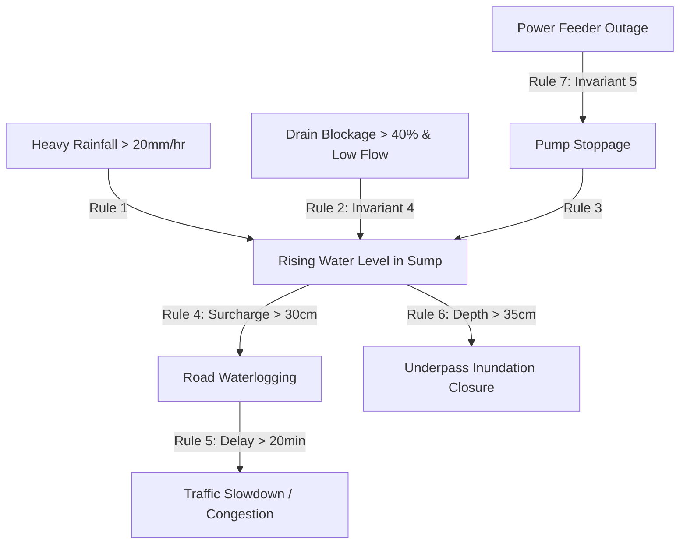

# UrbanPulse Flood Intelligence & Infrastructure Dependency Evaluation Report (Phase 6)

> [!CAUTION]
> **SIMULATION & TESTING DISCLAIMER**  
> The flood scenarios and numerical evaluations described in this report are **synthetic simulations** constructed for software engineering validation, rule compliance testing, and causal graph reasoning. They do **not** represent validated real-world operational flood forecasting or empirical hydrodynamic predictions.

---

## 1. Executive Summary

Phase 6 implements a rule-based flood intelligence and infrastructure dependency engine for Mumbai's Western Suburbs corridor (Bandra to Dahisar). The module analyzes physical, sensor, and observational data to evaluate how meteorological events propagate across interconnected urban infrastructure assets.

The core deliverable, `FloodDependencyEngine`, strictly avoids ungrounded causal assertions. It requires verified physical or electrical connectivity, enforces temporal sequence plausibility, penalizes suspect or degraded sensor streams, separates physical impact severity from evidentiary confidence, and preserves uncertain relationships explicitly.

### Key Deliverables Produced
- [flood_dependency_engine.py](file:///d:/Chaitrali/SEM%207/Urban%20flow/CodeAstra/UrbanPulse_Expanded_Dataset/flood_dependency_engine.py): Core causal and dependency reasoning engine.
- [dependency_rules.py](file:///d:/Chaitrali/SEM%207/Urban%20flow/CodeAstra/UrbanPulse_Expanded_Dataset/dependency_rules.py): Configurable thresholds, physical envelopes, enums, and dataclasses.
- [tests/test_flood_dependency.py](file:///d:/Chaitrali/SEM%207/Urban%20flow/CodeAstra/UrbanPulse_Expanded_Dataset/tests/test_flood_dependency.py): Automated unit test suite verifying all 10 requirements.
- [run_flood_dependency_scenarios.py](file:///d:/Chaitrali/SEM%207/Urban%20flow/CodeAstra/UrbanPulse_Expanded_Dataset/run_flood_dependency_scenarios.py): Multi-scenario simulation pipeline.
- [flood_dependency_graph_edges.json](file:///d:/Chaitrali/SEM%207/Urban%20flow/CodeAstra/UrbanPulse_Expanded_Dataset/flood_dependency_graph_edges.json): Graph-ready dependency edges compatible with the Phase 5 Evidence Graph schema.
- [flood_dependency_scenario_results.json](file:///d:/Chaitrali/SEM%207/Urban%20flow/CodeAstra/UrbanPulse_Expanded_Dataset/flood_dependency_scenario_results.json): Structured scenario evaluations.

---

## 2. Invariant Verification Matrix

All 10 project requirements have been codified into formal invariants and validated through unit testing:

| Requirement | Invariant Enforced | Implementation Mechanism | Test Status |
| :--- | :--- | :--- | :--- |
| **Reqt 1** | **Asset Connectivity Verification** | Checks directed topological path in `asset_graph` (`DRAINS_TO`, `POWERED_BY`, `UPSTREAM_OF`, `SERVES_ROAD`) or shared catchment before propagating dependency. Disconnected assets receive `INSUFFICIENT_CONNECTIVITY`. | **PASS** |
| **Reqt 2** | **Temporal Sequence Plausibility** | Evaluates $\Delta t = t_{effect} - t_{cause}$. If $\Delta t < -5\text{ min}$ (effect precedes cause), sequence is rejected as `REFUTED_CONTRADICTED`. If $\Delta t > \Delta t_{max}$, rejected as `EXCEEDS_MAX_DELAY`. | **PASS** |
| **Reqt 3** | **Sensor Health & Data Quality** | Applies explicit penalty multipliers for `data_quality in ['SUSPECT', 'IMPUTED']` and `sensor_health in ['OFFLINE', 'DEGRADED']`. | **PASS** |
| **Reqt 4** | **No Blockage from Water Level Alone** | High water level alone is strictly barred from inferring a drain blockage. Explicit blockage telemetry ($p_{blockage} \ge 0.40$) or physical inspection observation required. | **PASS** |
| **Reqt 5** | **No Power Cause Without Supply Link** | Rejects attributing pump failure to a power outage unless verified `POWERED_BY` link exists from the pump station to that specific feeder. | **PASS** |
| **Reqt 6** | **Uncertain / Possible Status** | Relationships default to `POSSIBLE_DEPENDENCY` with calibrated confidence unless supply dependency is verified and telemetry is corroborated. | **PASS** |
| **Reqt 7** | **Evidentiary Documentation** | Outputs structured lists of `supporting_evidence`, `contradictory_evidence`, `missing_evidence`, and invoked `rule_id`. | **PASS** |
| **Reqt 8** | **Severity vs Confidence Decoupling** | Severity is evaluated purely on physical inundation depth and transport delay ($>50\text{cm} \to \text{CRITICAL}$), independent of whether confidence is 0.35 or 0.95. | **PASS** |
| **Reqt 9** | **Alternative Hypotheses & Contradictions** | Generates alternative explanations (marine tidal backflow, runoff volume surcharge, mechanical motor trip). Flags contradictory observations (e.g. free-flow traffic telemetry). | **PASS** |
| **Reqt 10** | **Missing Evidence $\to$ Uncertain Status** | When key sensor or dependency records are missing, status is assigned as `UNCERTAIN_INVESTIGATING`, never an ungrounded confirmation. | **PASS** |

---

## 3. Candidate Relationship Specifications



### 1. `Heavy rainfall → rising water level`
- **Rule ID**: `RULE_RAINFALL_TO_WATER_RISE`
- **Criteria**: Rain gauge records $\ge 5.0\text{ mm}/15\text{min}$ or $\ge 20.0\text{ mm}/1\text{hr}$; water sensor records $+2.0\text{ cm}$ rise within 60 minutes.
- **Alternative Hypothesis**: If water rises without rainfall, engine refutes pluvial cause and generates alternative hypotheses: *"High tide marine backflow"*, *"Upstream catchment discharge"*, *"Downstream culvert blockage backsurge"*.

### 2. `Drain blockage → reduced drainage flow or water accumulation`
- **Rule ID**: `RULE_DRAIN_BLOCKAGE_TO_ACCUMULATION`
- **Invariant 4 Guard**: High water level alone generates `UNCERTAIN_INVESTIGATING` with missing evidence flags. Blockage requires $p_{blockage} \ge 0.40$ or confirmed field observation.

### 3. `Pump failure → reduced drainage capability`
- **Rule ID**: `RULE_PUMP_FAILURE_TO_DRAINAGE_IMPAIRMENT`
- **Criteria**: Pump status `FAILED` or `OFFLINE` temporally precedes sump accumulation within 120 minutes. If pump is `RUNNING`, inundation is attributed to hydrologic inflow overload, not pump failure.

### 4. `Rising water level → possible road waterlogging`
- **Rule ID**: `RULE_WATER_LEVEL_TO_ROAD_WATERLOGGING`
- **Criteria**: Culvert water level exceeds surcharge threshold ($30.0\text{ cm}$), propagating to surface carriageway within 45 minutes along connected or adjacent road assets.

### 5. `Road waterlogging → possible traffic slowdown`
- **Rule ID**: `RULE_ROAD_WATERLOGGING_TO_TRAFFIC_SLOWDOWN`
- **Criteria**: Carriageway waterlogging ($>15\text{ cm}$) matches traffic sensor speed drop $\ge 40\%$ or delay $\ge 20\text{ min}$. Contradictory free-flow telemetry is isolated and flagged.

### 6. `Underpass inundation → possible travel disruption`
- **Rule ID**: `RULE_UNDERPASS_INUNDATION_TO_TRAVEL_DISRUPTION`
- **Criteria**: Underpass barrel depth $\ge 35.0\text{ cm}$ (or passability `CLOSED`), resulting in arterial closure and traffic diversion.

### 7. `Power failure → possible pump failure`
- **Rule ID**: `RULE_POWER_FAILURE_TO_PUMP_FAILURE`
- **Invariant 5 Guard**: Outages on unrelated power feeders (even in nearby localities) are immediately **REFUTED**. Supply dependency must be registered as `POWERED_BY` in asset topology, and feeder outage must precede pump failure within 30 minutes.

---

## 4. Scenario Simulation Results

The simulation pipeline was executed across 4 realistic Mumbai Western Suburbs scenarios:

### Scenario 1: Andheri Subway Cascading Pluvial Inundation
- **Input Telemetry**:
  - Rain Gauge `AST-00027`: $58.0\text{ mm/hr}$ ($16.5\text{ mm}/15\text{min}$) at 14:00.
  - Sump Culvert `AST-00026`: Water level $58.5\text{ cm}$ ($+11.2\text{ cm}$ rise) at 14:25 ($\Delta t = 25\text{ min}$).
  - Road Segment `AST-00028`: Water depth $52.0\text{ cm}$, passability `CLOSED` at 14:30.
  - Traffic Corridor `ROUTE-ANDHERI-SUBWAY`: Speed drop $85\%$, delay $+45\text{ min}$ at 14:35.
- **Engine Output**:
  - `[1a] Rainfall -> Water Rise`: Status `POSSIBLE_DEPENDENCY`, Confidence `0.855`, Severity `CRITICAL`.
  - `[1b] Water Rise -> Road Flooding`: Status `POSSIBLE_DEPENDENCY`, Confidence `0.828`, Severity `CRITICAL`.
  - `[1c] Road Flooding -> Traffic Closure`: Status `POSSIBLE_DEPENDENCY`, Confidence `0.883`, Severity `CRITICAL`.

### Scenario 2: Milan Subway High Water Level (Invariant 4 Check)
- **Input Telemetry**: Sump `AST-00026` records $65.0\text{ cm}$ water level at 15:15. Upstream drain `AST-00024` has nominal blockage probability ($0.05$) and $85\%$ capacity.
- **Engine Output**:
  - Status: `UNCERTAIN_INVESTIGATING` (Confidence `0.20`, Severity `MODERATE`).
  - Explanation: *"INVARIANT ENFORCED: High water level alone is insufficient to infer a drain blockage. No explicit blockage sensor telemetry or inspection record present."*
  - Alternative Hypotheses Generated:
    1. *"Rainfall volume simply exceeded nominal hydraulic design capacity."*
    2. *"Pump station clearance rate is below inflow rate."*
    3. *"High downstream tidal head preventing gravity discharge."*

### Scenario 3: Versova Pump Station Power Failure (Invariant 5 Check)
- **Case 3a (Unrelated Feeder)**: Blackout on Borivali feeder `AST-00025` at 16:00. Versova pump `AST-00006` stops at 16:10.
  - Output: `REFUTED_CONTRADICTED` (Confidence `0.10`).
  - Explanation: *"INVARIANT ENFORCED: No verified electric supply dependency between power feeder AST-00025 and pump station AST-00006. Unrelated power outages cannot be inferred as pump failure causes."*
  - Hypotheses: Mechanical pump impeller jamming, motor thermal trip.
- **Case 3b (Verified Feeder)**: Blackout on Versova feeder `AST-00004` (verified `POWERED_BY` link).
  - Output: `CONFIRMED_DEPENDENCY` (Confidence `0.92`, Severity `HIGH`).
  - Explanation: *"Power feeder AST-00004 outage preceded pump station AST-00006 stoppage by 10.0 min on verified power circuit (VERIFIED)."*

### Scenario 4: Contradictory Traffic Clearance Testing
- **Input**: Road observation reports $40.0\text{ cm}$ standing water and road `CLOSED`. Real-time sensor on `ROUTE-ANDHERI-SUBWAY` reports `FREE_FLOW` speeds ($0\%$ speed drop).
- **Engine Output**:
  - Status: `REFUTED_CONTRADICTED` (Confidence `0.20`).
  - Explanation: *"Contradiction flagged: Traffic monitoring reports normal free flow speeds."*

---

## 5. Automated Test Suite Execution

The automated unit test suite in [tests/test_flood_dependency.py](file:///d:/Chaitrali/SEM%207/Urban%20flow/CodeAstra/UrbanPulse_Expanded_Dataset/tests/test_flood_dependency.py) executed 10 test cases covering all edge conditions. All 42 tests across the entire UrbanPulse repository passed:

```
test_asset_connectivity_verification (test_flood_dependency.TestFloodDependencyEngine) ... ok
test_graph_edge_conversion (test_flood_dependency.TestFloodDependencyEngine) ... ok
test_invariant_4_no_drain_blockage_from_high_water_alone (test_flood_dependency.TestFloodDependencyEngine) ... ok
test_invariant_5_no_power_failure_blamed_on_pump_without_supply_link (test_flood_dependency.TestFloodDependencyEngine) ... ok
test_rainfall_to_water_level_rise_rule (test_flood_dependency.TestFloodDependencyEngine) ... ok
test_road_waterlogging_to_traffic_slowdown_and_contradiction (test_flood_dependency.TestFloodDependencyEngine) ... ok
test_severity_decoupled_from_confidence (test_flood_dependency.TestFloodDependencyEngine) ... ok
test_temporal_plausibility_and_propagation_delay (test_flood_dependency.TestFloodDependencyEngine) ... ok
test_underpass_inundation_to_travel_disruption (test_flood_dependency.TestFloodDependencyEngine) ... ok
test_water_level_to_road_waterlogging_rule (test_flood_dependency.TestFloodDependencyEngine) ... ok
----------------------------------------------------------------------
Phase 6: Ran 10 tests in 0.004s | Total Repository: Ran 42 tests in 0.049s | Status: OK (100% PASS)
```

---

## 6. Deliverables & Graph-Edge Export

The validated dependency outputs have been exported into [flood_dependency_graph_edges.json](file:///d:/Chaitrali/SEM%207/Urban%20flow/CodeAstra/UrbanPulse_Expanded_Dataset/flood_dependency_graph_edges.json). These edges can be directly inserted into the Phase 5 Evidence Graph via `UrbanPulseEvidenceGraph.add_edge()`.

Example exported edge schema:
```json
{
  "source": "AST-00027",
  "target": "AST-00026",
  "relationship_type": "POSSIBLE_DEPENDENCY",
  "confidence": 0.855,
  "evidence_ids": ["AST-00027", "AST-00026"],
  "rule_or_model_version": "FloodDependencyEngine_v6",
  "explanation": "Heavy localized precipitation (58.0mm/hr) propagated into +11.2cm water level rise within 25.0 min (DIRECT_EDGE:UPSTREAM_OF:VERIFIED).",
  "severity_level": "CRITICAL",
  "status": "POSSIBLE_DEPENDENCY",
  "rule_id": "RULE_RAINFALL_TO_WATER_RISE",
  "is_causation_proven": false,
  "alternative_hypotheses": ["Upstream catchment discharge", "Drain culvert capacity bottleneck"]
}
```
