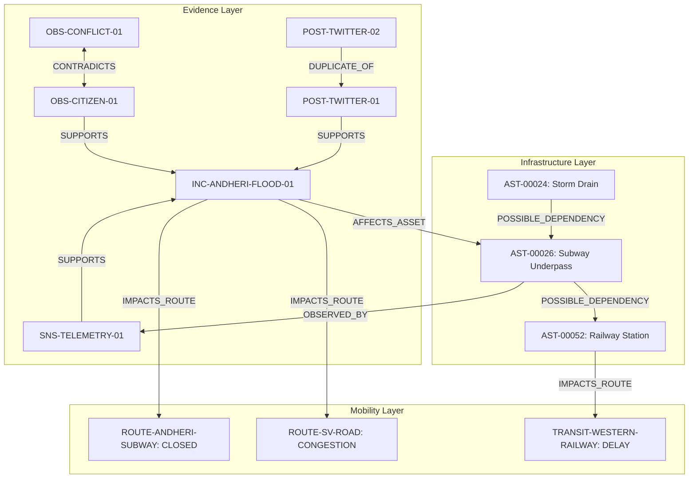

# UrbanPulse Evidence Graph Schema Documentation (Phase 5)

## 1. Architectural Overview & Design Philosophy

The UrbanPulse Evidence Graph models multimodal urban incident intelligence across Mumbai's Western Suburbs corridor (Bandra to Dahisar). Unlike traditional spatial road networks or basic knowledge graphs, this heterogeneous graph separates:
1. **Epistemic / Identity Relationships**: How observations, sensor telemetry, and social signals relate to one another and ground incident claims (`SUPPORTS`, `CONTRADICTS`, `DUPLICATE_OF`, `SAME_INCIDENT_CANDIDATE`).
2. **Physical Impairment & Mobility Disruptions**: How real-world incidents impair physical infrastructure assets and propagate delay across transit corridors (`AFFECTS_ASSET`, `POSSIBLE_DEPENDENCY`, `IMPACTS_ROUTE`, `OBSERVED_BY`).

### Core Safety Invariants Enforced
- **Zero Dangling Pointers**: Every node and edge endpoint must exist in the validated registry; unverified references are strictly barred.
- **Semantic Type Enforcement**: Edges cannot connect arbitrary node types (e.g., an `IMPACTS_ROUTE` relationship cannot connect two `OBSERVATION` nodes).
- **Separation of Identity vs Consequence**: Connected components clustering is restricted strictly to undirected identity subgraphs (`SAME_INCIDENT_CANDIDATE`). Running components across directed consequence edges is prohibited.
- **Repost Chain Compression**: Viral social retweets or repost chains (`DUPLICATE_OF`) are collapsed during evidence aggregation to count as 1 independent corroboration chain, preventing social media amplification.
- **Causation Disclaimer on Shortest-Paths**: Shortest-path routing indicates topological or spatial reachability avoiding blockages; it is **never** presented or interpreted as proof of physical causation.

---

## 2. Node Schema Taxonomy

Every node in the graph contains `node_id`, `node_type`, `label`, `locality`, optional geographic coordinates (`latitude`, `longitude`), and a timestamp.

| Node Type | Description | Key Attributes | Example |
| :--- | :--- | :--- | :--- |
| `INCIDENT` | Synthesized ground-truth urban incident cluster | `incident_category`, `severity`, `status`, `cluster_id` | `INC-ANDHERI-FLOOD-01` |
| `OBSERVATION` | Multimodal field report or citizen observation | `source_modality`, `source_reliability`, `text_raw`, `text_cleaned` | `OBS-CITIZEN-01` |
| `SENSOR` | Hardware sensor device or automated telemetry stream | `sensor_type`, `source_reliability`, `measured_depth_cm`, `status` | `SNS-TELEMETRY-01` |
| `SOCIAL_POST` | Ingested social media post (e.g., Twitter/X, civic forum) | `platform`, `is_repost`, `repost_parent_id`, `text_raw` | `POST-TWITTER-01` |
| `INFRASTRUCTURE_ASSET` | Physical urban asset (culvert, drain, pumping station, railway station) | `asset_type`, `elevation_m`, `design_capacity_lps`, `asset_status` | `AST-00026` (Subway Culvert) |
| `ROUTE` | Road corridor, arterial link, or flyover segment | `origin`, `destination`, `travel_mode`, `status` | `ROUTE-ANDHERI-SUBWAY` |
| `TRANSIT_SERVICE` | Commuter transit line or suburban railway corridor | `origin`, `destination`, `travel_mode`, `service_headway_min` | `TRANSIT-WESTERN-RAILWAY` |

---

## 3. Edge Schema Taxonomy

All edges require rich provenance, confidence, and human-readable rationale:
- `relationship_type`: Valid `EdgeType` enum value.
- `confidence`: Calibrated float score in range `[0.0, 1.0]`.
- `evidence_ids`: List of supporting source IDs that justify the edge creation.
- `rule_or_model_version`: Pipeline identifier (e.g., `RuleEngine_v3.1`, `CalibratedLightGBM_v4`).
- `timestamp`: Timezone-aware ISO 8601 string (`+05:30`).
- `explanation`: Human-readable justification explaining why the edge exists.

### Edge Categories & Semantics

| Edge Type | Category | Graph Semantics | Permitted Endpoints `(Source -> Target)` | Purpose |
| :--- | :--- | :--- | :--- | :--- |
| `SUPPORTS` | Evidence | Directed (`EVD -> INCIDENT` or `EVD -> EVD`) | `(OBSERVATION, INCIDENT)`, `(SENSOR, INCIDENT)`, `(SOCIAL_POST, INCIDENT)`, `(OBSERVATION, OBSERVATION)` | Establishes corroborating evidence backing an incident claim. |
| `CONTRADICTS` | Epistemic | Symmetric / Bidirectional | `(OBSERVATION, OBSERVATION)`, `(OBSERVATION, INCIDENT)`, `(SOCIAL_POST, INCIDENT)`, `(SENSOR, OBSERVATION)` | Records mutually exclusive factual claims (e.g., passable vs submerged). |
| `DUPLICATE_OF` | Epistemic | Directed (`Copy -> Original`) | `(SOCIAL_POST, SOCIAL_POST)`, `(OBSERVATION, OBSERVATION)` | Links viral reposts, copies, or duplicate payloads to the original root source. |
| `SAME_INCIDENT_CANDIDATE` | Identity | Symmetric / Undirected | `(OBSERVATION, OBSERVATION)`, `(SOCIAL_POST, OBSERVATION)`, `(SENSOR, OBSERVATION)`, `(INCIDENT, INCIDENT)` | Eligible pairs for connected-component cluster formation. |
| `AFFECTS_ASSET` | Consequence | Directed (`INCIDENT -> ASSET`) | `(INCIDENT, INFRASTRUCTURE_ASSET)`, `(OBSERVATION, INFRASTRUCTURE_ASSET)` | Connects an incident to physical asset inundation or failure. |
| `POSSIBLE_DEPENDENCY` | Consequence | Directed (`Upstream -> Downstream`) | `(INFRASTRUCTURE_ASSET, INFRASTRUCTURE_ASSET)` | Captures hydraulic, drainage, or physical cascading dependencies between assets. |
| `IMPACTS_ROUTE` | Consequence | Directed (`INC/ASSET -> ROUTE/TRANSIT`) | `(INCIDENT, ROUTE)`, `(INCIDENT, TRANSIT_SERVICE)`, `(INFRASTRUCTURE_ASSET, ROUTE)`, `(INFRASTRUCTURE_ASSET, TRANSIT_SERVICE)` | Propagates physical failure into mobility bottlenecks, closures, and transit delays. |
| `OBSERVED_BY` | Monitoring | Directed (`ASSET/ROUTE -> SENSOR`) | `(INFRASTRUCTURE_ASSET, SENSOR)`, `(ROUTE, SENSOR)` | Identifies hardware telemetry monitoring an asset or route segment. |

---

## 4. Query Engine & Graph Algorithm Specifications

The `UrbanPulseGraphQueries` engine provides 5 core query routines:

### 1. `get_incident_evidence(incident_id)`
- **Algorithm**: Directed BFS from incident node across incoming `SUPPORTS` and `SAME_INCIDENT_CANDIDATE` edges.
- **Duplicate Compression**: For every discovered evidence node, traverses outgoing `DUPLICATE_OF` edges. If the target is also discovered, the node is marked as a repost, preventing inflation of independent corroboration counts.

### 2. `get_incident_contradictions(incident_id)`
- **Algorithm**: Examines the incident and all supporting evidence nodes for incident-linked `CONTRADICTS` edges.
- **Safety**: Isolates contradictory claims so civic or emergency operators see both conflicting assertions without corrupting the confirmed incident cluster.

### 3. `get_connected_infrastructure(incident_id, max_hops=2)`
- **Algorithm**: Breadth-First Search initiating at `incident_id` along `AFFECTS_ASSET`, then traversing `POSSIBLE_DEPENDENCY` edges up to `max_hops`.
- **Output**: Returns upstream drainage bottlenecks and downstream dependent structures with explicit connection rationale.

### 4. `get_downstream_route_impacts(incident_id, max_hops=3)`
- **Algorithm**: Directed BFS exploring `IMPACTS_ROUTE` edges directly from the incident or through intermediate impaired assets. Computes cumulative impact confidence through chain multiplication ($C_{cum} = \prod C_i$).

### 5. `find_safe_alternative_route(start_node, end_node, blocked_nodes, road_network_graph)`
- **Algorithm**: Dijkstra / Shortest Path on the topological road network excluding blocked segments.
- **Mandatory Causation Guard**: Appends the mandatory causation notice:
  > *"NOTICE ON CAUSATION: Shortest path indicates spatial topological reachability avoiding blocked nodes. It does NOT assert or establish physical causal chains."*
